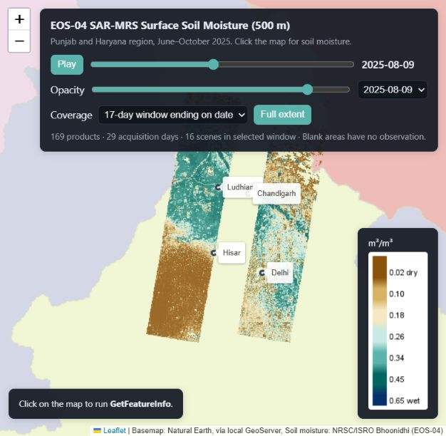
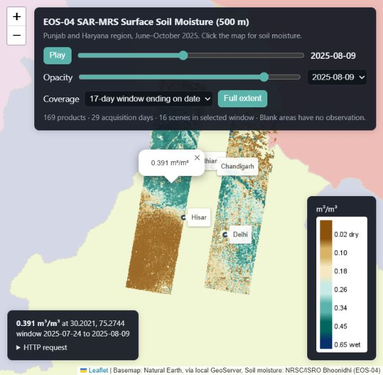

# EOS-04 soil moisture as a time-enabled WMS

This is the mid-semester practical for Cyber GIS: Geospatial Web and GeoBI (IIIT Hyderabad, October 2026). The task was to find a dataset on Bhoonidhi that has no OGC service and build one for it.

I picked the EOS-04 SAR soil moisture product (`EOS-04_SAR-MRS_SM`) and published it through GeoServer as an OGC WMS 1.3.0 layer with a TIME dimension. Any WMS client, such as QGIS, Leaflet or OpenLayers, can now ask for a soil moisture map of a given date, compare dates, and click a pixel to read its value. You don't need a Bhoonidhi login or any downloads to do that.



## Service

The service runs on GeoServer 3.0.1 on my laptop and is reachable from the internet through Tailscale Funnel. The public links work while the laptop is on and serving, which covers the evaluation period. Everything also runs on localhost if you set it up yourself.

| | |
|---|---|
| Public WMS endpoint | `https://sarthak-pc.tailad9fb7.ts.net/geoserver/bhoonidhi/wms` |
| Public web demo | https://sarthak-pc.tailad9fb7.ts.net/ |
| Try it | [GetCapabilities](https://sarthak-pc.tailad9fb7.ts.net/geoserver/bhoonidhi/wms?service=WMS&version=1.3.0&request=GetCapabilities), [map for 9 August 2025](https://sarthak-pc.tailad9fb7.ts.net/geoserver/bhoonidhi/wms?service=WMS&version=1.3.0&request=GetMap&layers=eos04_soil_moisture&styles=&crs=EPSG:4326&bbox=28,74,32,78&width=800&height=800&format=image/png&transparent=true&time=2025-08-09) |
| Local WMS endpoint | `http://localhost:8080/geoserver/bhoonidhi/wms` |
| Layer | `eos04_soil_moisture` (full name `bhoonidhi:eos04_soil_moisture`) |
| Operations | GetCapabilities, GetMap, GetFeatureInfo, GetLegendGraphic |
| Time dimension | 29 acquisition days, 3 June to 24 October 2025; the latest day is the default |
| CRS | EPSG:4326, CRS:84, EPSG:3857, EPSG:4269, EPSG:32643, EPSG:32644 |
| Local web demo | http://localhost:8080/geoserver/www/eos04-demo/index.html |

### How the public endpoint works

Tailscale Funnel gives the laptop a public HTTPS address. Requests go to Tailscale's relay servers, come back to the laptop over its existing Tailscale connection, and are handed to [`scripts/public_proxy.py`](scripts/public_proxy.py). That small gateway only lets read-only requests through to the soil moisture WMS, the demo page, the basemap and GeoServer's XML schemas. GeoServer's admin pages and REST API return 404 from outside, and WMS parameters that would make GeoServer fetch remote URLs are refused.

The gateway also passes the public hostname on to GeoServer, and the `bhoonidhi` workspace is set to build its URLs from it. So GetCapabilities points clients at the public address when you reach it from outside, and at localhost when you use it locally.

## The gap

Bhoonidhi does publish this product. Its [API specification](https://bhoonidhi.nrsc.gov.in/bhoonidhi-api/) lists `EOS-04_SAR-MRS_SM` as a STAC collection, and you can search it and download whole products once you log in. Bhoonidhi offers no map service for it, though. If you want to look at soil moisture for one region on two dates today, you have to:

1. log in and get an API token,
2. search the catalogue by area and date,
3. download every matching product as a ZIP,
4. extract the GeoTIFFs and handle the fill values,
5. stitch together scenes from the same day,
6. style everything yourself in a desktop GIS.

Then you do it all again for the next date. The service in this repo does that work once, on the server, so a client only has to send one HTTP request.

### How I checked that no WMS exists

I didn't want to rely on a quick look, so I wrote [`scripts/probe_gap.py`](scripts/probe_gap.py). It sends the requests below and saves every response, status code and timestamp. The summary is in [`evidence/gap_report.md`](evidence/gap_report.md) and the raw responses are in [`evidence/probes/`](evidence/probes/).

| What I checked | Result |
|---|---|
| Bhoonidhi API documentation | STAC is mentioned 12 times. WMS, WMTS, WCS, OGC, GetCapabilities and GetMap are never mentioned. |
| `EOS-04_SAR-MRS_SM` in the docs | Listed, as a STAC collection only |
| Catalogue and search requests without a login | HTTP 401 |
| 70 WMS, WMTS and WCS GetCapabilities requests on Bhoonidhi hosts, at the usual GeoServer, MapServer and MapProxy paths | None returned an OGC capabilities or exception document |
| Bhoonidhi's Vista viewer | Uses its own token-protected backend. An anonymous request returned a Java error page. |
| Bhuvan's public WMS | No soil moisture layer in its capabilities |
| VEDAS GeoServer paths | No public capabilities document |

Probing guessed paths can't prove that no internal or undocumented service exists. What it does show is that there is no documented, public, standards-based way to get this product as a map.

### Why WMS

People mostly use this product to look at moisture across a region and see how it changes between passes, for irrigation, monsoon onset or drought. A WMS fits that use: clients get rendered maps at any scale and in several projections, and the TIME parameter matches the satellite's 17-day revisit. GetFeatureInfo still gives the actual number in m³/m³ when someone needs it. If you need the raw rasters for analysis, WCS would be the better standard, and GeoServer can add it to the same layer later.

## How it works


### Data

I downloaded every result for a search box over Punjab and Haryana (74 to 78 E, 28 to 32 N) between June and October 2025. That came to 169 products on 29 acquisition days, 90.69 MB as ZIPs. Whole products extend past the search box, so the data reaches roughly 72 to 80 E and 26 to 34 N, in swaths rather than full coverage.

Each product is a 600 × 600 GeoTIFF in EPSG:4326 with 0.005 degree pixels (about 500 m) and two float32 bands. Band 1 holds volumetric soil moisture in m³/m³. The product is described in SAC's [algorithm document](https://bhoonidhi.nrsc.gov.in/bhoonidhi_resources/help/docs/ATBD_EOS04_SSM_Dec2023_v2.pdf), which combines EOS-04 SAR with SMAP radiometer data.

[`scripts/prep_rasters.py`](scripts/prep_rasters.py) turns these into the files GeoServer reads:

- It keeps band 1 and sets `-9999` as nodata, along with any value that is not finite or falls outside 0 to 1.
- It leaves the native grid and pixel values untouched.
- It writes compressed Cloud Optimized GeoTIFFs (58.78 MB in total) with internal tiles and overviews.
- It names each file `sm_YYYYMMDDT000000_<hash>.tif`, so GeoServer can read the date from the name, and the hash keeps overlapping scenes from overwriting each other.

[`scripts/verify_data.py`](scripts/verify_data.py) then compares every output pixel of all 169 products against the source. They match exactly. The results are in [`evidence/data_verification.md`](evidence/data_verification.md).

I made two judgement calls on the data:

- Band 2 contains the codes -9999, -1, 0 and 1, and the product metadata doesn't say what they mean. I don't use it as a quality mask. The original files keep it.
- 4,113 pixels are above 0.65, the nominal maximum in the algorithm document, but still within 0 to 1. I kept their values, so you can query them, and the colour ramp simply tops out at 0.65.

### GeoServer setup

[`scripts/configure_geoserver.py`](scripts/configure_geoserver.py) sets everything up through GeoServer's REST API, and you can re-run it safely. It creates a `bhoonidhi` workspace with its own WMS endpoint, an ImageMosaic store over the prepared files, the layer and its SLD style. The date index is defined in [`indexer.properties`](geoserver/mosaic/indexer.properties) and [`timeregex.properties`](geoserver/mosaic/timeregex.properties).

The TIME dimension lists the 29 days and defaults to the latest one (2025-10-24). Scenes from the same day are mosaicked into one map. A date that isn't in the list returns an `InvalidDimensionValue` exception rather than a blank image. You can also ask for a range such as `2025-10-08/2025-10-24`, which mosaics everything acquired in that window. The mosaic doesn't average anything: where two scenes overlap, the more recent day is drawn on top.

GetFeatureInfo reports the band as `soil_moisture` in m³/m³. The style runs from brown (dry) through teal to blue (wet).

### Demo client

[`demo/index.html`](demo/index.html) is a small Leaflet page served by GeoServer itself. It has a date slider and dropdown, play and pause, opacity, the legend, and click-to-query. It also has a "17-day window" mode, which shows a full orbit cycle of swaths ending on the chosen date. Leaflet is bundled in the repo. The base map comes from GeoServer's Natural Earth sample layers, so the page needs nothing from the internet.



### Using it in QGIS

1. Open Data Source Manager, go to WMS/WMTS and add a new connection with the URL `http://localhost:8080/geoserver/bhoonidhi/wms`.
2. Connect, select `eos04_soil_moisture`, choose PNG and add the layer.
3. Use Identify Features on a coloured pixel to see its value.
4. If your QGIS version shows the WMS time dimension under the layer's temporal properties, turn it on and step through the dates with the Temporal Controller.

## Example requests

In WMS 1.3.0, a BBOX in EPSG:4326 is written as latitude, longitude. Use CRS:84 if you want longitude, latitude.

- [GetCapabilities](http://localhost:8080/geoserver/bhoonidhi/wms?service=WMS&version=1.3.0&request=GetCapabilities)
- [Map for 9 August 2025](http://localhost:8080/geoserver/bhoonidhi/wms?service=WMS&version=1.3.0&request=GetMap&layers=eos04_soil_moisture&styles=&crs=EPSG:4326&bbox=28,74,32,78&width=800&height=800&format=image/png&transparent=true&time=2025-08-09)
- [17-day window ending 24 October 2025](http://localhost:8080/geoserver/bhoonidhi/wms?service=WMS&version=1.3.0&request=GetMap&layers=eos04_soil_moisture&styles=&crs=EPSG:4326&bbox=28,74,32,78&width=800&height=800&format=image/png&transparent=true&time=2025-10-08T00:00:00Z/2025-10-24T23:59:59Z)
- [Legend](http://localhost:8080/geoserver/bhoonidhi/wms?service=WMS&version=1.3.0&request=GetLegendGraphic&layer=eos04_soil_moisture&format=image/png)
- [Value at a pixel near Ludhiana](http://localhost:8080/geoserver/bhoonidhi/wms?service=WMS&version=1.3.0&request=GetFeatureInfo&layers=eos04_soil_moisture&query_layers=eos04_soil_moisture&styles=&crs=EPSG%3A4326&bbox=30.9%2C75.81%2C30.905%2C75.815&width=5&height=5&i=2&j=2&format=image%2Fpng&info_format=application%2Fjson&time=2025-08-09). It returns 0.232 m³/m³ at 30.9025 N, 75.8125 E.
- [A date with no data](http://localhost:8080/geoserver/bhoonidhi/wms?service=WMS&version=1.3.0&request=GetMap&layers=eos04_soil_moisture&styles=&crs=EPSG:4326&bbox=28,74,32,78&width=256&height=256&format=image/png&time=1990-01-01), which returns an `InvalidDimensionValue` exception.

## Testing

[`scripts/test_wms.py`](scripts/test_wms.py) runs 51 checks against the live endpoint with real HTTP requests, and all 51 pass. The full report is in [`evidence/compliance_report.md`](evidence/compliance_report.md), and the same 51 checks also pass through the public URL ([`evidence/compliance_report_public.md`](evidence/compliance_report_public.md)). The checks cover:

- the capabilities document validating against the WMS 1.3.0 XML schema and advertising the layer, CRS list, style, legend and TIME values,
- maps in PNG and JPEG, the lat/lon axis order for EPSG:4326, CRS:84 giving the same image, and Web Mercator output,
- every listed date rendering, different dates giving different maps, the default date, time ranges, and the exception for an unknown date,
- GetFeatureInfo returning the same value as the source raster, in JSON, plain text, HTML and GML,
- the legend, plus the correct exception codes for a bad layer, style, CRS, format, pixel position or operation.

## Running it yourself

You need GeoServer (I used 3.0.1), Python 3.10 or newer, and a Bhoonidhi account for the download step. Using the WMS itself needs no account.

```powershell
pip install -r requirements.txt

# Start the GeoServer Windows service if it is not running (may need admin rights)
powershell -ExecutionPolicy Bypass -File scripts/run_geoserver.ps1

# Search and download; asks for your Bhoonidhi login and does not save it
python scripts/fetch_bhoonidhi.py --bbox 74 28 78 32 --start 2025-06-01 --end 2025-10-31 --max 169

# Prepare the rasters, verify them, publish the layer and run the tests
powershell -ExecutionPolicy Bypass -File scripts/publish_local.ps1
```

The downloader refreshes its token when it expires, retries failed downloads, checks each ZIP and records sizes and SHA-256 hashes in `data/download_manifest.json`. If you run it again, it skips products it already has. To resume the exact same set of products, use `python scripts/fetch_bhoonidhi.py --saved-items --max 169`.

If your GeoServer is not at `http://localhost:8080/geoserver` with the default admin login, set `GEOSERVER_URL`, `GEOSERVER_USER` and `GEOSERVER_PASSWORD` before running the configuration script.

To make your copy public the same way, start the gateway and point Tailscale Funnel at it (Funnel has to be enabled for your tailnet first):

```powershell
python -u scripts/public_proxy.py --port 8099
tailscale funnel --bg 8099
```

Never point a tunnel at GeoServer's port 8080 directly, because that would expose the admin pages.

The rasters are not in git. To move the service to another machine without downloading everything again, `python scripts/package_submission.py` writes a code bundle and a 59 MB data bundle to `submission/`. Extract both into the same folder, install the requirements, then run `configure_geoserver.py` and `test_wms.py`. Only `verify_data.py` needs the original ZIPs.

## Limitations

- The layer covers one region and one season. It does not cover all of India and doesn't pick up new acquisitions automatically; you have to re-run the scripts.
- A date in the TIME list means the satellite passed somewhere in the area that day, not everywhere. Places it didn't observe are transparent, which means no data rather than zero moisture.
- Overlapping scenes from the same day are mosaicked, not averaged, and I haven't applied any quality screening because band 2 is undocumented.
- The pixels are 0.005 degrees, so their size in metres changes slightly with latitude.
- The public URL is served from my laptop, so it only answers while the laptop is on, GeoServer and the gateway are running, and Funnel is enabled. It will go offline after the evaluation.
- GeoServer reads the rasters straight from `data/mosaic/`, so that folder has to stay where it is.

## Repository layout

```
scripts/      download, preparation, verification, GeoServer setup, tests and the public gateway
geoserver/    ImageMosaic index settings and the SLD style
demo/         Leaflet client (Leaflet is bundled)
evidence/     gap probes, test and verification reports, screenshots
data/         download manifest and granule list (the rasters themselves are not committed)
```

Data: NRSC/ISRO Bhoonidhi. Algorithm: SAC/ISRO. Base map: Natural Earth. Leaflet is used under its BSD-2-Clause licence, included in `demo/vendor/leaflet/`.
